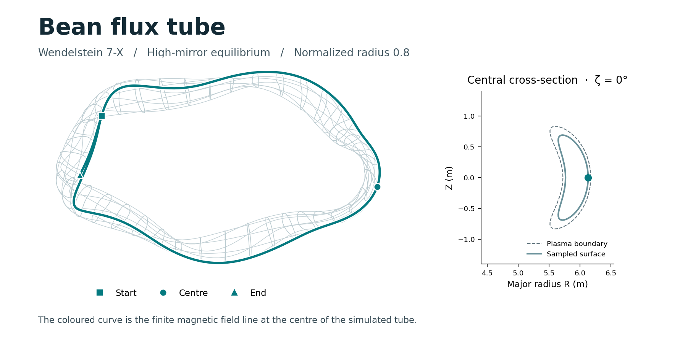
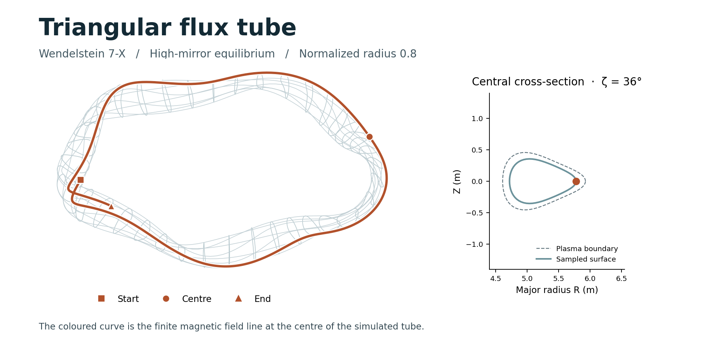

# Labyrinth · product requirements

**User and purpose.** A stellarator transport researcher needs to judge whether a Wendelstein 7-X heat-flux estimate is accurate enough to justify a longer simulation. Labyrinth puts the sampled field line, the solver output and an independent reference in the same view.

**Release decision.** Ship a replay that requires **$0 in cloud compute**. Qualify a live two-GPU demonstration under a **$40 cumulative Modal ceiling**. The W7-X live run is proposed. Its feasibility, runtime and accuracy on Modal await rehearsal.

## Live versus replay

| Experience | What the researcher sees | Acceptance |
|---|---|---|
| Locate the tubes · replay | High-mirror W7-X geometry at normalized radius 0.8. Select the bean or triangular field line. Unsampled regions stay gray. | The bean field strength agrees with all 129 saved stella samples to their printed precision. |
| Advance plasma · live after qualification | Nonlinear GX on two A100s. GPU 0 advances the bean tube and GPU 1 advances the triangular tube. Each solves its own local plasma state. | Rehearse from initialization and verify checkpoint continuation. Show both device IDs, overlapping solver execution, advancing simulation clocks and newly generated flux samples. If either worker fails, label and play the saved run. |
| Check transport · live comparison with replayed evidence | Overlay new bean ion heat flux with public stella and GENE traces. Show the triangular published mean separately. | Match geometry, gradients, units and time coverage. For raw GX normalizations with identical dimensional references, multiply time by √2 and divide heat flux by 2√2 to obtain archive units. Compare time-weighted means on 200–300 and 300–400 when covered. Claim saturated agreement only for a covered stationary window with sampling uncertainty. |
| Inspect spatial parallelism · replay | On the **separate Dommaschk geometry**, show two GPUs advancing coupled toroidal regions of one GENE-X case, with MPI exchanges and a CPU field solve. | Saved checkpoints assign planes 1–3 and 4–6 to different ranks. All four controlled runs passed the reference. CPU averaged 184.69 s and GPU 145.44 s (1.27×). The live W7-X tubes are independent. |

**Accuracy fixtures.** In ion gyro-Bohm units the archived bean means are **2.242** for stella over 1500–1900 and **2.474** for GENE over 1500–1893.765. A reduced Modal stella run produced **5.79** on 300–400 versus **2.55** and **2.68** in the archives. Display that discrepancy. The triangular result has a published mean of **2.22** over 1200–1500. A raw triangular trace remains unverified. [Published benchmark](https://doi.org/10.1017/S0022377822000393) · [Public trace archive](https://github.com/stellaGK/stella/blob/6f60964da55e9c0207b2ed9912d8903440b6d68b/AUTOMATIC_TESTS/quick_benchmarks/DOI_10_1017_S0022377822000393.h5)

**Forecast replay.** Predict the next 50-unit local mean from the previous completed window, reveal the archived observations, update and repeat. Using 1450–1500 for initialization, stella mean absolute error is 0.0444 versus 0.0423 for a frozen forecast. Show both scores. Simulated magnetic corrections remain a later milestone requiring a validated coil response, state transfer across equilibria and matched divertor and core-energy measurements.

**Stack.** React, TypeScript, Three.js and Plotly display versioned geometry, traces and run metadata. Python, NumPy, h5py and NetCDF prepare the data. Modal hosts explicitly launched GX workers. Record solver revision, units, coverage, runtime and verification outcome with each result.

## Budget and presentation figures

| Scenario | Time and cost | Interpretation |
|---|---|---|
| Live demo | **$1.53 for 15 minutes** at about $6.10/hour for two A100-40GBs, eight CPU cores and 32 GiB. | Two one-hour rehearsals plus one live slot cost about **$13.73**. Including $8.10 provisionally posted earlier gives **$21.83** planned. |
| Published full-resolution stella bean tube | **161 hours on 288 processors**, or **46,368 CPU-hours**. | Measured on the authors’ system for one local tube. |
| Full-grid stella on Modal to normalized time 1900 | **14–15 days, $3,100–$3,200**. If the stable timestep halves: **28–30 days, $6,200–$6,400**. | Estimate from three explicit-streaming startup steps: about 65,700 steps at roughly 19 s/step and $9.15/hour for 32 CPU cores and 192 GiB. Long-run timestep, I/O and restarts can change the total. |
| Published GPU-native GX bean benchmark | **28 minutes on one GPU** at 4 Laguerre × 8 Hermite moments; **90 minutes on four GPUs** at 8 × 16. | Different velocity resolutions. Use as rehearsal context; only a measured Labyrinth run establishes its timing. |

Before each allocation, reconcile billed and pending usage, allow for setup, idle time, storage and egress, and set resource limits and a hard timeout within the remaining $40. Terminate after retrieval. Use replay when the next slot cannot fit. [Modal pricing](https://modal.com/pricing) · [GX benchmark, §6.2](https://www.cambridge.org/core/journals/journal-of-plasma-physics/article/gx-a-gpunative-gyrokinetic-turbulence-code-for-tokamak-and-stellarator-design/2C4BB81955E7E749B95B8B8141E997FA)

## Field-line paths

Each curve traces the centre of a finite flux tube on the same magnetic surface. The names describe the cross-section at the centre of each path. Coordinates were computed from the high-mirror VMEC equilibrium using the straight-field-line angle correction. The triangular image shows geometry; its colour identifies the path. [Source equilibrium](https://github.com/stellaGK/stella/blob/6f60964da55e9c0207b2ed9912d8903440b6d68b/AUTOMATIC_TESTS/numerical_tests/test_5_fluxtube/wout_w7x_kjm.nc)

