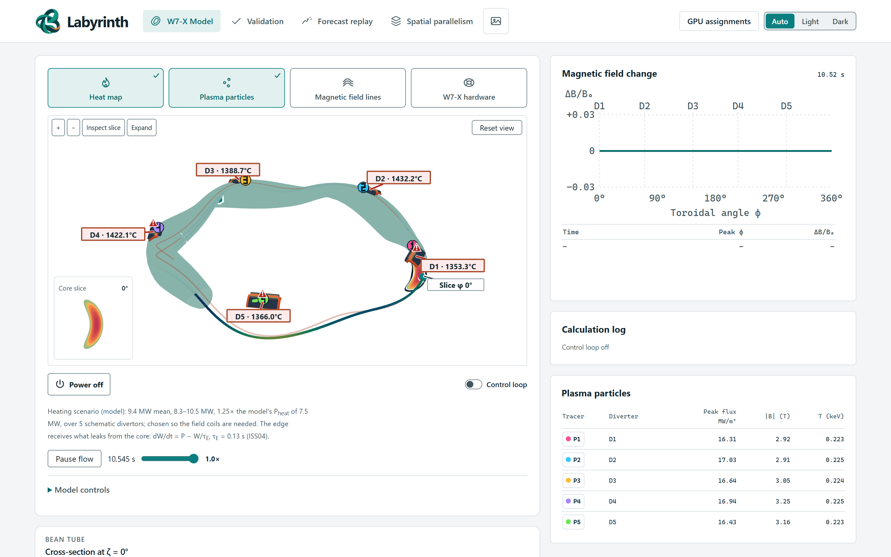

# Labyrinth

Labyrinth is a desktop-browser tool for one question in W7-X turbulence work: **is this heat-flux estimate accurate
enough to justify a longer simulation?** It puts the field line a gyrokinetic run samples, the solver's heat-flux
trace and an independent reference trace side by side, and states what the evidence does and does not support.

It is built on public data: the W7-X high-mirror ("KJM") VMEC equilibrium and the stella/GENE benchmark archive of
González-Jerez et al. 2022 ([doi:10.1017/S0022377822000393](https://doi.org/10.1017/S0022377822000393)), pinned by
sha256 in [`data/raw/README.md`](data/raw/README.md).



*The W7-X Model view. The surface, field lines and |B| are computed from the VMEC equilibrium; the divertor
temperatures are an illustrative model (see below).*

## What is validated

Each number below is recomputed from pinned inputs by `main/` on every build, checked by the test suite and
re-derived by an independent verifier (see `tasks/*/VERIFY.md`).

**1. Field-line geometry: |B| matches stella to 2.9 × 10⁻¹³.**
Our tracer solves the straight-field-line equation θ* = θ + λ(s, θ, ζ) on the VMEC equilibrium and evaluates |B|
along the line. Against stella's own run of the same case (`test_2_geometry`, ρ = 0.7, 25 samples):

| Reference | Agreement | Source |
|---|---|---|
| stella float64 `bmag` (`EXPECTED_OUTPUT…out.nc`) | max \|Δ\| = 2.94 × 10⁻¹³ in \|B\|/B_ref (tolerance 10⁻¹⁰) | [stella @ `6f60964d`](https://github.com/stellaGK/stella/blob/6f60964da55e9c0207b2ed9912d8903440b6d68b/AUTOMATIC_TESTS/numerical_tests/test_2_geometry/EXPECTED_OUTPUT.vmec_geometry.out.nc) |
| stella printed `.geometry` table (4 sig. figs) | 25/25 samples within printed precision | same directory |
| stella bean-tube geometry at ρ = 0.8 (129 samples, Modal run) | all \|B\| and toroidal angles within printed precision | `data/raw/stella-modal-bean/` (D-029) |

`artifacts/geometry.json` publishes the float64 error as a conservative upper bound (4 × 10⁻¹³: the raw error × a
headroom factor, rounded up) so the artifact rebuilds byte-identically on any CPU; the raw 2.94 × 10⁻¹³ is in the
verifier's record ([`tasks/01-geometry/VERIFY.md`](tasks/01-geometry/VERIFY.md)). An independent bisection solver
(no Newton) reproduces the same figure.

**2. Heat-flux traces: stella vs GENE, with uncertainty.**
From the archived nonlinear bean-tube ion heat-flux traces (Q_i/Q_gB vs t·v_th,i/a), Labyrinth computes
time-weighted window means and an autocorrelation-aware standard error (Sokal-windowed τ_int, N_eff = window/2τ_int):

| Window | stella | GENE | Reading |
|---|---|---|---|
| 1500–1900 / 1500–1893.765 | 2.242 ± 0.019 (N_eff ≈ 12) | 2.474 ± 0.017 (N_eff ≈ 14) | **the two codes disagree** by ≈ 0.23, about 9 combined standard errors |
| 300–400 | 2.55 (stderr not resolvable) | 2.68 ± 0.021 | |
| 200–300 | 2.72 (stderr not resolvable) | 2.93 ± 0.035 | |

- The published means (2.242, 2.474, 2.55, 2.68) are reproduced at their printed precision.
- The standard errors are approximate and are lower bounds: τ_int is not well converged in these short windows.
  The estimator was checked by Monte-Carlo on AR(1), AR(2) and filtered noise (90–98 % interval coverage).
- **No window supports a "saturated" claim.** That needs a covered, stationary window with finite uncertainty and
  N_eff ≥ 20, and no archive window has it. The tool says so rather than drawing a converged-looking number.
- Numbers the PRD reports but we cannot recompute (the reduced Modal run's 5.79, the triangular tube's 2.22) are shown
  as *reported*, never as computed.

Method and rationale: [`architecture.md`](architecture.md) § Science pipeline, decisions D-013, D-017, D-025 in
[`decision.md`](decision.md). Values: `artifacts/transport.json`.

> **Where to see it.** Open the **Validation** tab (`#/validation`). It shows the tracer checks with their reference
> files and hashes, then the stella and GENE traces with ±1σ bands, window statistics and the PRD fixtures (claimed vs
> recomputed). The same checks run in the test suite (`main/tests/`, `renderer/src/features/{geometry,transport,validation}`).

## What is illustrative: the divertor model

The heating, divertor and tile temperatures in the W7-X Model view are **a teaching model, not a W7-X simulation**.
Its provenance is labelled `model` throughout.

- **Real inputs:** the flux-surface shape, |B| on nine surfaces, and the last-closed-flux-surface field lines all come
  from the same VMEC reader and tracer that pass the checks above.
- **Physically structured, simplified:** a fixed heating power with energy conserved; a 0-D core energy balance with
  ISS04 confinement; a textbook two-point scrape-off-layer model per divertor; |B| compression narrowing the strike
  line; 1-D conduction through 6 mm CFC tiles into a water-cooled sink.
- **Chosen, not measured:** the divertors are schematic (positions and wetted areas), the heating scenario is set to
  1.25 × the nominal 7.5 MW so the control loop has something to do, and the coil response, strike-line width and
  radiated fraction are illustrative parameters.

Do not read divertor temperatures, heat loads or control-loop timings as predictions for W7-X. The full model and its
caveats: [`tasks/10-heat-field/MODEL.md`](tasks/10-heat-field/MODEL.md), decisions D-031 to D-037.

## Other views

- **Validation:** the evidence above, as described.
- **Forecast replay:** persistence vs frozen forecasts of the heat-flux trace on 50-unit windows, with error statistics.
- **Spatial parallelism:** how a replayed GENE-X run distributes work across ranks and GPUs (Dommaschk case).
- **Live GX (optional):** launching GX on Modal GPUs is off by default, needs a qualified rehearsal run, and every
  launch is gated by a budget guard against a $40 ceiling. Everything else is replay and costs nothing.

## Run it

```bash
pip install -r main/requirements.txt && npm --prefix renderer ci
cd main && python3 -m labyrinth_main.build_artifacts   # recompute artifacts/ from data/raw/
npm --prefix renderer run dev                          # UI on http://localhost:5173 (replay, no backend needed)
bash scripts/verify.sh                                 # all checks: tests, schemas, boundaries, artifact freshness
```

The checks are bash scripts and CI runs on Ubuntu; on Windows run them inside WSL (see [`CLAUDE.md`](CLAUDE.md)).

## Repository map

| Path | Contents |
|---|---|
| `main/` | Python backend: VMEC reader and tracer, transport statistics, forecast, budget, live-GX orchestration, HTTP API |
| `renderer/` | React/TypeScript front end (Three.js, Plotly) |
| `artifacts/` | Deterministic JSON the backend writes and the UI reads, validated against `contracts/*.schema.json` |
| `data/raw/` | Pinned upstream inputs with sha256 and source commits |
| `tasks/NN-*/` | Expected outcomes per feature (`TASK.md`) and independent verification records (`VERIFY.md`) |
| [`PRD.md`](PRD.md) · [`architecture.md`](architecture.md) · [`decision.md`](decision.md) · [`status.md`](status.md) | Requirements, design, decision log, current state |
